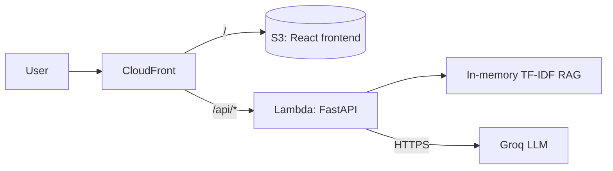

# Assistente Diversa — Inclusive Education

A RAG chatbot about inclusive education, based on articles from the [Diversa Portal](https://diversa.org.br/). Graduation project by **Team Hélice** (SoulCode Academy / Accenture).

The web version separates the original prototype (a Gradio notebook) into a FastAPI API and a React interface. The notebook is available in [notebooks/](notebooks/README.md).

## Architecture



The `POST /api/chat` flow validates the input, checks whether the question is in scope (out-of-scope questions receive a redirect), retrieves articles, builds a profile-specific prompt, calls Groq, and post-processes the response. If no Groq key is configured or the request fails, the API responds in demo mode.

| Method | Route | Purpose |
|---|---|---|
| GET | `/api/health` | Status and number of indexed articles |
| GET | `/api/profiles` | Profiles, greetings, and suggested questions |
| POST | `/api/chat` | `{pergunta, perfil, historico}` → `{resposta, perfil, fontes, origem}` |

Version 1 does not use a database: articles are stored in `backend/app/data/artigos.csv`, chat history is stored in the browser (`localStorage`), and each interaction is recorded as a JSON line in the log.

## Project Structure

```
backend/    FastAPI API (app/api, core, services, repositories, schemas, data) and tests
frontend/   React + Vite + TypeScript
infra/      SAM template (Lambda, S3, CloudFront, and budget) and deployment script
notebooks/  Original Gradio prototype
```

## Run Locally

Configure the Groq key by copying `.env.example` to `.env` in the project root (`GROQ_KEY=...`). The key is optional.

```bash
# API at http://localhost:8000
cd backend
python3 -m venv .venv && .venv/bin/pip install -r requirements-dev.txt
.venv/bin/uvicorn app.main:app --reload --port 8000

# Frontend at http://localhost:5173 (in another terminal)
cd frontend
npm install && npm run dev
```

Backend tests: `cd backend && .venv/bin/pytest`.

### With Docker

```bash
docker compose up --build   # frontend at http://localhost:5173, API at http://localhost:8000
```

The `backend/app` and `frontend/` source directories are mounted in the containers: saving a file restarts the API through `uvicorn --reload` and refreshes the browser through Vite. The Groq key is read from the root `.env` file. If dependencies change (`requirements.txt` or `package.json`), run the command again with `--build`.

To test the production setup (the compiled frontend served by nginx, which forwards `/api/` to the API, as CloudFront does on AWS):

```bash
docker compose -f docker-compose.prod.yml up --build   # http://localhost:8080
```

## Backend Configuration

Environment variables (or `.env`):

| Variable | Default | Purpose |
|---|---|---|
| `GROQ_KEY` | empty | Groq API key (also accepts `GROQ_API_KEY`) |
| `GROQ_MODEL` | `openai/gpt-oss-20b` | Model to use |
| `CORS_ORIGINS` | `http://localhost:5173` | Comma-separated list of allowed origins |
| `RATE_LIMIT_POR_MINUTO` | `20` | Requests per IP on `/api/chat` |
| `MAX_CHARS_PERGUNTA` | `1000` | Maximum question length |
