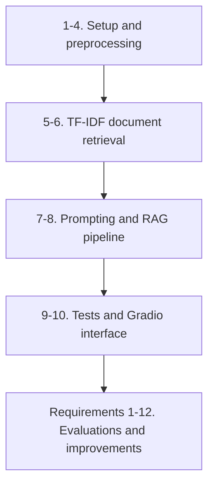

# Assistente Diversa — Inclusive Education

A working prototype developed as the graduation project of **Team Hélice (SoulCode Academy / Accenture)**.

**Assistente Diversa** is a chatbot focused on **inclusive education**, powered by a curated collection of articles from the [Diversa Portal](https://diversa.org.br/). It uses a **RAG (Retrieval-Augmented Generation)** architecture: it retrieves relevant documents using TF-IDF and generates responses tailored to the end user's profile through large language models (LLMs) via the **Groq** API (Llama 3.1).

---

## Run the Project

Follow these steps to run the prototype locally.

### 1. Set Up the Environment
Open a terminal in the `notebooks/` directory:
```bash
# Create a virtual environment
python3 -m venv venv

# Activate the virtual environment
# Linux/macOS:
source venv/bin/activate
# Windows (Command Prompt):
venv\Scripts\activate

# Install dependencies
pip install -r requirements.txt
```

### 2. Configure API Keys (`.env`)
The assistant requires a Groq key to enable AI-generated responses. Without it, the prototype runs in static demo mode.
1. Get API keys from the [Groq console](https://console.groq.com/) and [Hugging Face](https://huggingface.co/).
2. Create or edit the `.env` file in the project root and add:
```env
GROQ_KEY=your_key_here
HUGGINGFACE_API_KEY=your_key_here
```

### 3. Run the Notebook
With the environment activated, start Jupyter:
```bash
jupyter notebook
```
In your browser, open `prototipo_funcional_assistente_diversa.ipynb` and run all cells (`Cell -> Run All` or press `Shift + Enter` sequentially). The URL for the interactive **Gradio** web interface will appear in the relevant cell (`http://127.0.0.1:7860`).

---

## Notebook Architecture

The `prototipo_funcional_assistente_diversa.ipynb` notebook is organized into the following incremental stages:


### Project Requirements (1-12)

The prototype's development is guided by 12 requirements, organized and evaluated in the notebook:

1. **Requirement 1: Expand the Knowledge Base**
   * Expand the corpus to more than 20 articles from the Diversa Portal, covering topics such as autism (ASD), ADHD, visual, hearing, and intellectual disabilities, assistive technology, specialized educational services, and legislation.
2. **Requirement 2: Hallucination Mitigation**
   * Add system prompt instructions that prevent the model from inventing article titles and URLs and require it to stay grounded in retrieved excerpts.
3. **Requirement 3: Automated Test Suite**
   * Create and document a structured test suite covering correct answers, out-of-scope redirects, and potential failures.
4. **Requirement 4: Ethics and Risk Assessment**
   * Assess ethical compliance, production limitations, and risk mitigation in real educational settings.
5. **Requirement 5: Model Selection and Configuration**
   * Document the choice of model (`llama-3.1-8b-instant` or equivalent), free-tier rate limits, and error handling.
6. **Requirement 6: User Interface Styling**
   * Style the interface with custom CSS and visual references from Team Hélice.
7. **Requirement 7: User Profile Configuration**
   * Tailor responses (temperature and token limits) to the selected profile (teacher, family, or administrator).
8. **Requirement 8: Dynamic Gradio Controls**
   * Use interface elements such as dropdowns, buttons, and profile selectors.
9. **Requirement 9: Conversation History and Persistence**
   * Persist conversation history and isolate session context by user profile.
10. **Requirement 10: Usage Metrics and Dashboards**
    * Record logs in real time (`timestamp`, `profile`, `question`, `article_title`, `retrieved_articles`, `similarity_score`) and visualize them with box plots and analytical tables.
11. **Requirement 11: Advanced Semantic Search (Embeddings)**
    * Use multilingual embeddings through the Hugging Face API to support semantic search and synonyms.
12. **Requirement 12: Model Benchmarking and Fallback**
    * Compare Groq models for latency and response quality.

---

## Additional Resources
* **`style.css`**: CSS stylesheet used to customize the Gradio interface.
* **`imagens_do_tcc/`**: Graphics used in the chat interface, including autism-related imagery and Team Hélice icons.
* **`artigos.csv`**: Structured knowledge base from the Diversa Portal.
